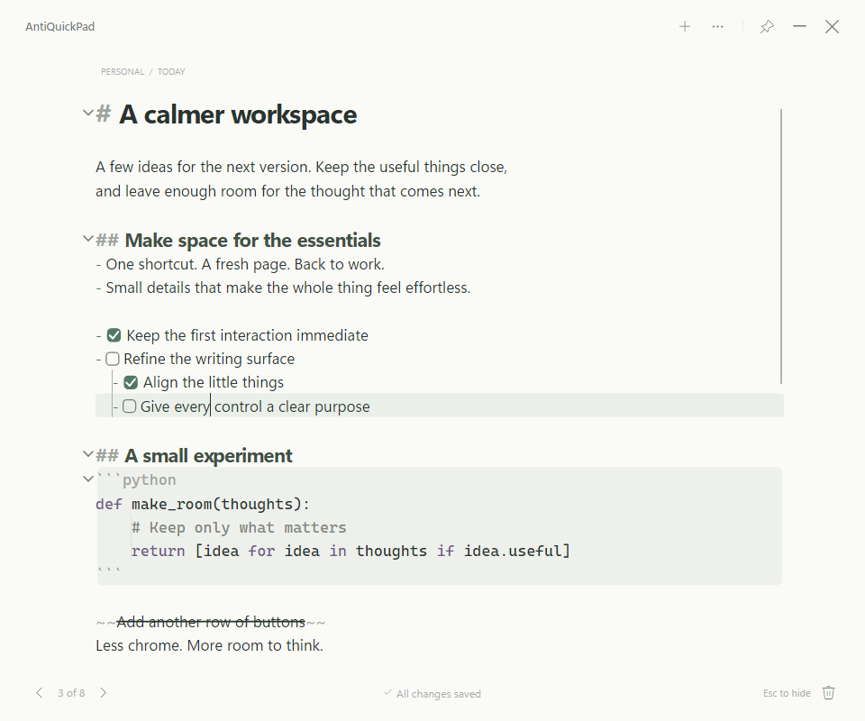
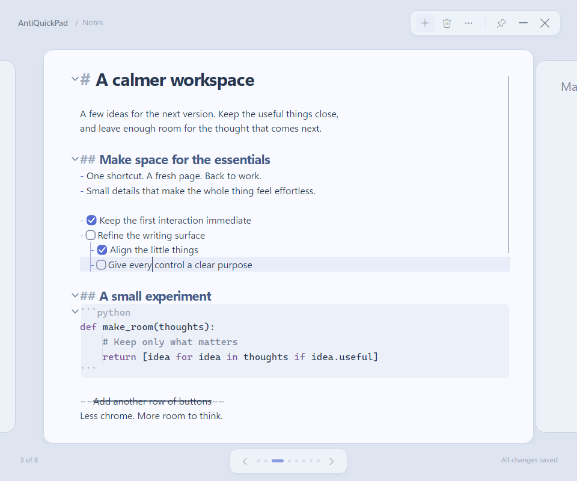
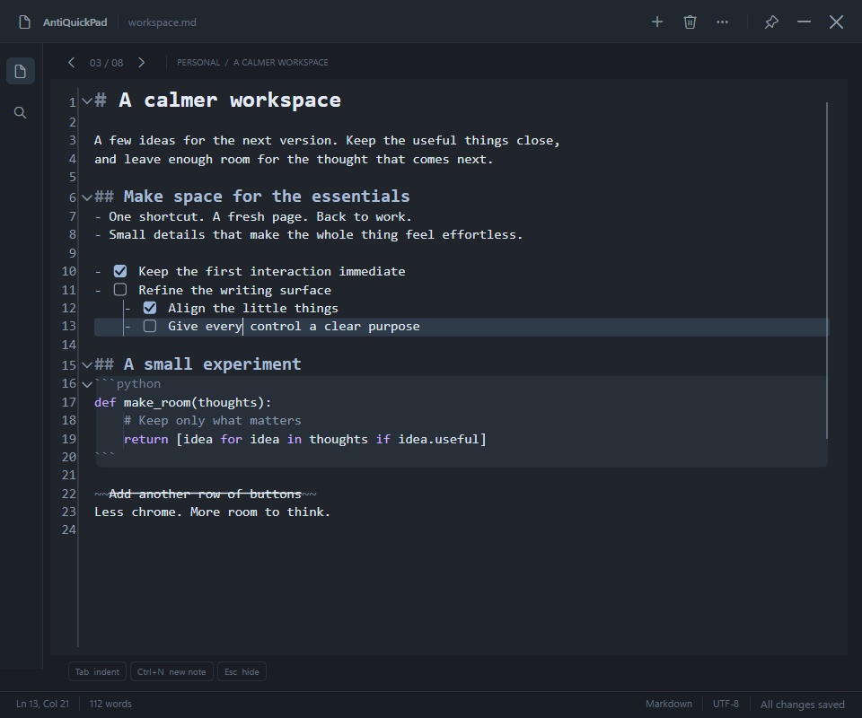

# M6 — three ways to make room for a thought

These are **real Avalonia 12.1.4 / AvaloniaEdit 12.0.0 renders**, generated locally from `src/AntiQuickPad/Design`. Each direction uses the production `EditorFactory.Create(Look)`: the existing Markdown/Python colorizer, code-panel, checkbox, active indent-guide and strike renderers, document scanner and folding manager. The new margin replaces stock fold boxes with clickable chevrons. A design-only renderer adds the active line. No browser, raster mockups, downloads or simulated backdrop.

All frames are 960 × 800 client DIPs, rendered by `RenderTargetBitmap` at 1× and 1.5× vector scale (960 × 800 and 1440 × 1200 pixels). The standard Windows title bar, DWM shadow and OS corners are outside the captured client visual tree. **The live window remains opaque and uses standard decorations.** Internal Card corners/shadows are real Avalonia Borders; they do not depend on transparent HWND corners.

The fixed main fixture contains H1/H2, prose, bullets, nested completed/open tasks, a Python fence, an indented caret at line 13 / column 21, and a struck line. `main` uses subdued bars; `bars` shows full-strength bars with the More control highlighted. `menu` opens an in-tree menu surface so it is included in RTB. `carousel` is a deterministic intermediate translation of two full-width real editor trees, rather than a photograph of a running animation. `empty` loads an actually empty editor and adds a hint overlay. A Viewbox applies the vector scale before RTB rasterization at 96 DPI; direct 144-DPI RTB capture produced doubled nested text and missing menu contents on this build and was rejected. The 1.5× frames test raster scale, not physical monitor switching or Windows text-size accessibility settings.

The design host is deliberately separate from resident notes, autosave, tray and global hotkey registration. It never opens the user's notes. Pin, minimize, hide and More are real controls; the New/Delete/navigation and menu command **layouts** are review candidates, not a second notes application. Settings and folder commands are proposed affordances. Selecting a design still requires integrating its shell with `MainWindow` and `CarouselController`. The normal entry point and default appearance are unchanged.

## A · Quiet

A generous writing surface with one clear left edge and almost no furniture.  
Small monochrome controls sit at the edges; the page itself has no container.  
For the person who summons the pad, writes a thought, and leaves.



| State | 1× | 1.5× |
|---|---|---|
| Main | [PNG](quiet/main@1x.png) | [PNG](quiet/main@1.5x.png) |
| Bars / More hover | [PNG](quiet/bars@1x.png) | [PNG](quiet/bars@1.5x.png) |
| More menu | [PNG](quiet/menu@1x.png) | [PNG](quiet/menu@1.5x.png) |
| Mid-slide | [PNG](quiet/carousel@1x.png) | [PNG](quiet/carousel@1.5x.png) |
| Empty | [PNG](quiet/empty@1x.png) | [PNG](quiet/empty@1.5x.png) |

**Changes vs today.** Replaces the row of labeled rectangular buttons and full-width status box with a unified, quiet top toolbar and a baseline of navigation/save information. New and More live at top-right; Previous/Next and `3 of 8` live at bottom-left; delete is kept at the opposite edge. Pin, minimize and hide retain a consistent trailing order. A muted collection eyebrow provides orientation without another panel. Future hover-reveal changes only bar opacity/hit testing, keeping the writing surface still; keyboard focus must also reveal the bars.

**Design details.** Segoe UI Variable Text, 17 DIP body / 30 H1 / 22 H2; 4/8/12/24 spacing rhythm, roughly 100 DIP writing inset. Segoe Fluent Icons at 15 DIP in 32 × 30 controls (compact desktop targets). No line numbers; 16 DIP chevron lane. The sage active row and active indent guide are visible without turning into another box. Real 14 DIP rounded checkboxes, 6 DIP rounded code background, and a narrow muted scrollbar. Only the menu/control hover has an internal radius; no fake rounded outer window or painted exterior shadow. Save state stays centered and page count remains textual.

**Motion proposal — not implemented.**

| Feedback | Proposed behavior | Difficulty / reason |
|---|---|---|
| F5 show/hide | Keep the resident window alive; immediate focus, then optional short opacity settle. Respect reduced motion. Use native minimize/restore where appropriate. | **Medium**. Avalonia Show/Hide does not by itself establish the requested Windows shell animation; exact native hide behavior needs a Win32 spike. Do not delay focus for an animation. |
| F21 scroll | 100–140 ms eased interpolation of the real vertical ScrollViewer offset; rapid wheel input retargets the destination. | **Medium**. `EditorViewport` already reaches the real viewer; clamp to extent and preserve horizontal carousel routing. |
| F22 caret | A short position interpolation, capped at one row on typing; jump immediately for large navigation and IME composition. | **Hard**. Needs a custom caret visual while the logical caret/selection/IME stay authoritative. |
| F23 folds | Brief fade/clip of the collapsing section, then commit the real folded layout. | **Hard**. AvaloniaEdit changes visual lines immediately; requires a temporary snapshot/overlay and careful scroll anchoring. |

**Limits hit.** Natural font metrics control leading. Code text remains flush to the code-panel left edge; the design does not claim inner padding. Checkbox rows use the existing baseline-preserving renderer. Custom chevrons escape the brush-only stock margin limit. Low-strength idle chrome needs the user's contrast judgment on their monitor.

**Estimated effort after selection:** 2–3 working days for shell/editor styling, menu command wiring, hover/focus reveal and DPI checks; motion work is additional (shared estimate below).

## B · Card

A note has a physical place in a small collection.  
Two neighbouring edges, a lifted page, and a floating pager make the carousel legible.  
For the person who thinks in several short notes at once.



| State | 1× | 1.5× |
|---|---|---|
| Main | [PNG](card/main@1x.png) | [PNG](card/main@1.5x.png) |
| Bars / More hover | [PNG](card/bars@1x.png) | [PNG](card/bars@1.5x.png) |
| More menu | [PNG](card/menu@1x.png) | [PNG](card/menu@1.5x.png) |
| Mid-slide | [PNG](card/carousel@1x.png) | [PNG](card/carousel@1.5x.png) |
| Empty | [PNG](card/empty@1x.png) | [PNG](card/empty@1.5x.png) |

**Changes vs today.** Moves the note into an 816 DIP-wide card with real inset content and visible neighbouring edges, rather than filling a rectangular editor viewport. The top action cluster and bottom pager float on the canvas, independent of the page; count and saved state balance the lower corners. Page dots supplement the exact count. The bars can later reveal on edge hover/focus without resizing cards. In the empty state, `9 of 9` moves the selected dot to the collection's last visible position; a production collection larger than eight needs a sliding dot range or compressed indicator.

**Design details.** Segoe UI Variable Text, 16 DIP body / 30 H1 / 22 H2. An 8 DIP rhythm with 44 DIP card padding and 16 DIP corner radius. The opaque pale card has a fine boundary and a small real BoxShadow against a blue-grey canvas. Floating controls use 12 DIP corners. Periwinkle active row, softly rounded 15 DIP checkboxes, subdued chevrons without line numbers, and a narrow scrollbar. A pill marks the active page among dots. Carousel frames translate two full-size editor cards, keeping line-wrap width constant.

**Motion proposal — not implemented.**

| Feedback | Proposed behavior | Difficulty / reason |
|---|---|---|
| F5 show/hide | Show/focus immediately; a very small whole-surface settle, not a zoom that reflows text. Native minimize/restore when available. | **Medium**. Needs compositor measurement and reduced-motion path; exact Windows show/hide remains a separate native investigation. |
| F21 scroll | Eased vertical note scrolling while card position stays fixed. Cancel interpolation on text selection/scrollbar drag. | **Medium**. Same ScrollViewer technique; must distinguish vertical scrolling from page gestures. |
| F22 caret | Short interpolation only within the active card; snap on a page change. | **Hard**. Native caret replacement plus coordinate transforms during a slide; never animate IME anchors. |
| F23 folds | A short clipped content transition inside the card; the card bounds and floating toolbar remain stable. | **Hard**. Snapshot plus real folded layout, scroll anchoring, and no stale interactive checkbox hit targets. |

**Limits hit.** Natural line height and flush-left code text remain. A visual pass found the last fixture line clipped; the final card uses smaller body type and revised vertical padding to fit it. The neighbouring slivers are static edge surfaces in resting frames; mid-slide uses a second real editor. The OS shadow is not present in RTB. More layers and shadows mean this direction needs the most GPU/gesture measurement before adoption.

**Estimated effort after selection:** 4–6 working days including production carousel/card geometry, edge peeks, collection-aware dots, toolbar command wiring, pointer/focus reveal and DPI checks; motion additional.

## C · Pro

An orderly tool for people who navigate with the keyboard.  
A compact toolbar, numbered gutter and useful status line establish a working rhythm.  
For longer scratch notes, code fragments and frequent movement between pages.



| State | 1× | 1.5× |
|---|---|---|
| Main | [PNG](pro/main@1x.png) | [PNG](pro/main@1.5x.png) |
| Bars / More hover | [PNG](pro/bars@1x.png) | [PNG](pro/bars@1.5x.png) |
| More menu | [PNG](pro/menu@1x.png) | [PNG](pro/menu@1.5x.png) |
| Mid-slide | [PNG](pro/carousel@1x.png) | [PNG](pro/carousel@1.5x.png) |
| Empty | [PNG](pro/empty@1x.png) | [PNG](pro/empty@1.5x.png) |

**Changes vs today.** A 48 DIP toolbar and compact collection strip replace the wrapping button row. A narrow navigation rail separates collection tools from note actions. A 30 DIP bottom status strip contains line/column, word count, Markdown/UTF-8 and save state; shortcut hints sit just above it. The status changes to line 1 / column 1 and 0 words for the genuinely empty document. Top and bottom live in overlay slots so future hover-reveal can preserve viewport geometry. The extra rail and status information make this intentionally denser than the other two directions.

**Design details.** Consolas body 15 DIP / H1 25 / H2 20, paired with Segoe UI Variable Text for controls. 4/8/12/16 spacing, line numbers and a 16 DIP custom chevron lane. Broad slate active row, brighter active indent guide, 13 DIP checkboxes with 3 DIP radius, a 6 DIP code-panel radius, and narrow muted scrollbar. Hairline separators define toolbar, gutter and status rather than separate floating boxes. Page count is compact `03 / 08`. Menu corners are 10 DIP; the main surface relies on the opaque standard window's real OS treatment.

**Motion proposal — not implemented.**

| Feedback | Proposed behavior | Difficulty / reason |
|---|---|---|
| F5 show/hide | Immediate focus/visibility; native minimize/restore; optional very short opacity settle only. | **Medium**. Preserve resident behavior and measure focus before decoration; exact shell hide animation requires a native probe. |
| F21 scroll | Short, restrained 80–100 ms wheel interpolation; PageUp/PageDown and scrollbar dragging stay direct. | **Medium**. Existing ScrollViewer access, but wheel ownership and interrupted animation need care. |
| F22 caret | A short same-line interpolation; snap for multicaret/selection, jumps, page changes and IME. | **Hard**. Custom visual must not change the logical editor caret or accessibility/IME reporting. |
| F23 folds | Prefer a fast fade with stable gutter markers; animate content height only after a successful spike. | **Hard**. AvaloniaEdit has immediate folding and variable-height wrapped visual lines. A height animation is not an exposed switch. |

**Limits hit.** Dense natural font metrics are intentional; no custom leading. Code-panel inner padding is still unavailable. The default Cascadia Mono choice appeared too heavy during visual QA; the final candidate uses Consolas with an explicit regular base typeface before the production Markdown transformer. The rail/search and shortcut chips are proposed shell affordances; this task does not implement a search feature. Exact line/word state is fixture-driven here and must be bound to the live document on integration.

**Estimated effort after selection:** 3–4 working days for toolbar/status/rail styling and live bindings, menu wiring, hover/focus reveal and DPI checks; search functionality is outside this estimate; motion additional.

## Shared motion budget and boundaries

Engineering estimates, not measured delivery promises: 1–2 days for an F5 native-window spike and reversible treatment, 1–2 days for F21 wheel interpolation, 2–4 days for F22 custom caret, 3–5 days for an F23 folding spike. Exact macOS-style leading or exact OS shell animation through only stock AvaloniaEdit properties is **not feasible**; custom work or a less ambitious behavior is required. Animated folding may be rejected after the spike. Do not hold input/focus behind animation; reduced motion disables decorative movement. Horizontal carousel motion already exists in the product; these stills do not validate its feel or performance in the new layouts.

## F25a-resident-backdrop-probe: resident-window live check

Run from `src/AntiQuickPad` after the Release build:

```powershell
dotnet bin/Release/net10.0/AntiQuickPad.dll --probe-backdrop acrylic --theme dark --tint 45 --report ../../.coord/scratch/F25a/live-acrylic.txt
# Materials: none, mica, acrylic, blur. Defaults: theme dark, tint 60.
# Optional: --close-after-ms 600 (after an 800 ms settling period).
```

The independent 960 x 800 window uses the resident pad's BorderOnly decorations,
extended client area, 58 DIP native title-bar drag strip and resizable edges.
It creates a real editable AvaloniaEdit note with the shipping Quiet light/dark
palette. The window, root, editor, TextArea and template containers (including the
ScrollViewer) have transparent backgrounds on this instance. TextView exposes no
Background property. One canvas-colour tint layer sits behind the editor. Local
code-panel, checkbox and active-line drawing retains Quiet styling; these small
painted areas are distinct from the full-window tint. The opaque canvas fallback
is used when the requested backdrop is unavailable. No notes store, hotkey, tray
or singleton channel is opened.

Keys work while typing: **Ctrl+Alt+1/2/3/4** selects none/mica/acrylic/blur;
**Ctrl+Alt+T** switches theme; **Ctrl+Alt+Down/Up** steps tint through
0, 15, 30, 45, 60, 75, 90, 100%; **Ctrl+Alt+H** toggles the bottom-left HUD;
**Esc** closes and records the pick. Theme changes preserve in-memory text,
caret and viewport. The HUD shows requested material and actual granted level.

Reports go to stdout and optionally `--report`: OS, Avalonia version, timestamped
start, actual-level changes, user changes, settled state and **final:** at close.
Read the last `final:` line for material, actual level, theme and tint. An actual
level is capability evidence, not a visual-quality verdict. Check bright and dark
wallpaper, inactive appearance, movement, resizing and text sharpness live.
At 100% tint the canvas covers the backdrop; compare with 0% using the same
material to judge the opacity hypothesis. `none` is an opaque baseline.

The previous standard-decorated text-only probe and historical reports do not
establish the resident pad's appearance. See the current
[F25a-resident-backdrop-probe report](../../../.coord/reports/F25a-resident-backdrop-probe.md)
for build, selftest and two short capability recordings.

## Validation

Final Release build: **0 warnings / 0 errors** ([log](build.log)). Final `--selftest`: **exit 0** ([log](selftest.log)); scripted resident show-to-focus **2.667 / 1.605 / 1.089 ms**. All 30 final PNGs were individually viewed and passed dimension checks ([manifest](render-manifest.json)). One measurement-child timeout was recovered with graceful quit and an isolated unchanged-binary retry; retained [failure log](selftest-timeout.log). No physical hotkey-to-paint or future motion performance is claimed.

## Reproduce and validate

```powershell
# From src/AntiQuickPad; manager already restored dependencies.
dotnet bin/Release/net10.0/AntiQuickPad.dll --quit
$env:AVALONIA_TELEMETRY_OPTOUT='1'
dotnet build -c Release --no-restore -p:UseSharedCompilation=false
foreach ($direction in 'quiet','card','pro') {
    dotnet bin/Release/net10.0/AntiQuickPad.dll --render-design $direction "../../docs/design/m6/$direction"
}
dotnet bin/Release/net10.0/AntiQuickPad.dll --selftest
```

Render flags bypass the normal singleton and data paths, use a fixed fixture, render five states at both scales, then gracefully close. Neither restore nor network access is required. The selftest exercises the production resident path; it does not measure future motion or a selected design integrated into that resident path. See [T-011 report](../../../.coord/reports/T-011.md) for final checks and user-eye items.

## Comparison

| | Quiet | Card | Pro |
|---|---|---|---|
| Main organizing idea | One writing surface | A spatial collection | A keyboard workspace |
| Top/bottom bars | Minimal edge toolbar + quiet footer | Floating tool/pager capsules | Compact toolbar + useful status |
| Page position | Text count + arrows | Peeks + dots + exact count | Compact fraction + collection strip |
| Editor | Airy proportional text, no numbers | Padded paper card, no numbers | Dense monospace, numbered gutter |
| Borders/corners | Almost invisible; OS exterior | Internal radius/elevation; OS exterior | Hairline divisions; OS exterior |
| Strongest advantage | Least visual competition | Clearest carousel identity | Most information in reach |
| Main tradeoff | Muted idle controls | Less writing area, more layers | More persistent visual structure |
| Selection estimate, excluding motion | 2–3 days | 4–6 days | 3–4 days |
| First human check | Readability and restraint | Card spacing and page-switch feel | Body weight, density, status usefulness |


