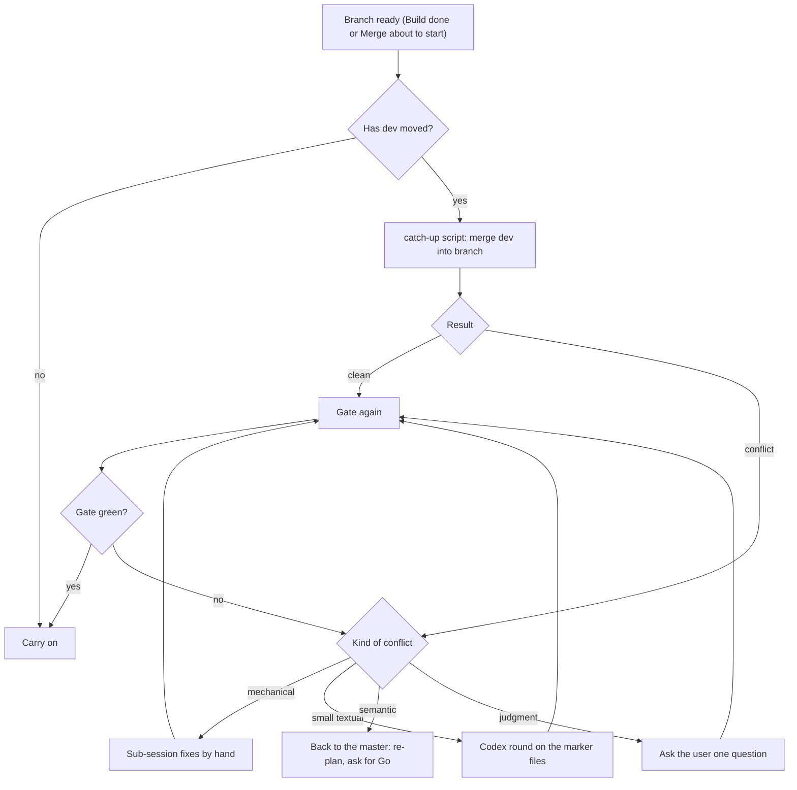

# Loop v2.2: plan (proposal, not a rule)

Status: **proposal** from `C30-loop-docs-v22-plan` (user request, 2026-10-29). Nothing here changes `docs/loop.md`. Each
step below is an unnumbered `step:` name; the user confirms scope before any of it gets an ID (`docs/loop.md`, "Numbering").
A plain-words version is in `docs/wiki/Loop-v2.2-Plan.md`.

## Why
Today (v2.1) the loop is built for one item at a time. `docs/loop.md` allows several items "only if their Files lists do
not overlap", but nothing checks it, nothing brings a branch up to date with dev, and `/merge-task` simply stops on a
conflict. As soon as two items run side by side, those three gaps decide whether it goes smoothly.

What the scout found (evidence for every "Now" below):
- `tools/gate.ps1:215-222`: changed files are `git diff dev...HEAD` (three-dot, from the merge base) plus working changes,
  ignoring `.coord/`. Merging dev into a branch therefore does **not** make dev's files look out of scope.
- The gate builds and tests the branch alone, never "branch plus the latest dev". A clash between two items shows first at
  `/merge-task` step 4 (gate on dev after the local merge commit exists; nothing is pushed on failure).
- `tools/dev.ps1` replaces any running dev copy from any checkout (C25), so there is one dev copy and one hand test at a time.
- Codex caps are shared across worktrees (C28); STATUS and `.coord/lessons.md` are master-owned.
- Hot files: `product/AntiNotepad/SelfTest/Contracts.cs` and `SelfTest.cs` are in the Files list of nearly every bug fix
  (A55 lists both), so a naive "no shared file" check would block almost everything.

Cost words used below: **zero** = a script, no model tokens; **small** = a few lines in a session that is already open;
**medium** = one extra short model turn; **large** = a Codex run or a new sub-session. No token counts are given: there is
no measurement behind any number yet.

## 1. Parallelism

| Topic | Now | Proposed | Cost | Touches |
|---|---|---|---|---|
| Overlap check | Rule in prose only (`docs/loop.md`, "Branches, worktrees and commits"). Nobody compares Files lists. | `tools/files-overlap.ps1 <ID-slug>`: reads `## Files` of this card and of every other open card (every `git worktree list` path that has a `.coord/tasks/*.md` past Go). Prints shared paths. **Hot files** (`Contracts.cs`, `SelfTest.cs`, `docs/loop.md`) are a WARN (append-only, mechanical conflicts); any other shared path is a FAIL for `/next-task` at Go time: start the second item only after the first merges, or re-plan its Files. Also run as a gate step so a Files edit in rework is re-checked. | zero | new script; `tools/gate.ps1` (one step); `/next-task` step 3; item template note |
| Read-only phases overlap Build | Implied: the master can plan one item while another builds, but this is written nowhere. | State it: Request, Findings (scout or Codex audit) and Plan of item B may run while item A is in Build, Check or Hand test, because they edit only B's own card on B's own branch. B's **Go** waits for the overlap check. | zero (rule text) | `docs/loop.md` phases section; `/next-task` |
| Limit on items in flight | None. | At most **2** items past Go (Build, Check, Hand test) plus any number in the read-only phases. Reason: one dev copy, one user to hand test, shared Codex caps. Raised only on the user's word. | zero | `docs/loop.md` rules; `tools/loop-card.ps1` can count and warn |
| Hand tests vs the single dev copy | `tools/dev.ps1` kills and replaces the dev copy from any checkout, so two items "in hand test" would replace each other's build. Not written next to the parallel rule. | A **hand-test queue**, oldest accepted first. A sub-session whose item is accepted waits (quiet relay: one line) until the master says "your turn"; only then it runs `tools/dev.ps1`. The master tells the next one when the user records a pass or a fail. Items without UI checks skip the queue. | small | `/review-task` step 5; master reply rule; STATUS "In flight" line |
| How the master tracks several cards | The status card says "several items in flight: one card each" and the hook lists them from STATUS. | A small **In flight** table in STATUS "Now" (item, phase, tier, branch, sub-session, waiting on): one row per item, rewritten at every phase change (already required by "Status always current"). The master's reply card is for the item being discussed; the table covers the rest. | small | STATUS layout (master-owned); `tools/loop-card.ps1` reads it |

## 2. Catching up with dev

**Method: merge dev into the branch, never rebase.** Branches are pushed (`docs/loop.md`: push freely), and a rebase needs a
force push. The final merge into dev stays `--no-ff`, so dev still gets only merges plus one status commit each.

| Topic | Now | Proposed | Cost | Touches |
|---|---|---|---|---|
| When | Never. The branch is cut from dev at Request and is not updated again. | Two points. (a) **Before Check**: when Build ends and before the gate in `/review-task` step 2, if `dev` has moved (`git merge-base --is-ancestor dev HEAD` is false), catch up first, so the gate and the reviews see the code that will really be merged. (b) **Before Merge**: `/merge-task` step 2 re-checks the same test. If dev moved since (another item merged during the hand test), catch up again. After (b), the user re-tests only if the incoming dev changes touch the item's Files or the code those files call (the sub-session lists both and the user decides); otherwise the existing hand test stands and the gate decides. | zero for the test; small for a clean merge | `/review-task` step 2; `/merge-task` step 2 |
| Who | Nobody. | The item's own **build/review sub-session** (it has the card and the worktree). A script does the mechanics; the master never merges dev into a feature branch, never resolves conflicts, and only checks the result. | small | new script; both skills |
| How | - | `tools/catch-up.ps1 <ID-slug>`: `git fetch`, refuse if the worktree is dirty, `git merge dev` inside the worktree, print `UP TO DATE`, `CLEAN` (with the incoming file list) or `CONFLICT` (list of conflicted files, each marked hot-file or other). Commit message `<ID-slug>: catch up with dev`. | zero | new script |
| After | - | Always re-run `tools/gate.ps1 -Task <ID-slug>` (build, selftest with CONTRACTS, scope). A clean merge with a green gate adds no model call. A red gate after a clean merge is a semantic clash: triage cause `plan` or `code` as below. | zero | `/review-task` |
| Gate scope | Three-dot diff from the merge base. | Verified as already safe: after a merge from dev the merge base moves to dev's tip, so dev's files are not "out of scope". No gate change needed for this. | none | none |
| Pushed state | - | Push the branch after every catch-up so the remote copy is the one that gets merged. | zero | skills |

## 3. Merge conflicts

Conflicts show up at a catch-up. Triage them like any failure (`docs/loop.md`, "Triage, lessons, scores") with one more
cause, `conflict`, added to the `/review-task` step 4a table.

| Kind | Looks like | Who resolves | Then |
|---|---|---|---|
| **Mechanical** | Both sides appended to a list: `CONTRACTS` rows, `SelfTest.cs` checks, using lines, a doc table. No line was edited by both for meaning. | The sub-session, by hand in the worktree (a few lines in an open session). Never "take ours/theirs" wholesale. | Gate must pass; the card's Check gets one line naming the files. |
| **Textual, small** | The same lines edited by both, but the intent is clear from the two cards. | A Codex **round** (`<ID-slug>-rN`) with a brief limited to the conflicted files: the sub-session runs the merge and leaves the markers (Codex cannot write `.git`), Codex edits only the marker files, the sub-session commits. | Gate + the other item's `CONTRACTS` rows + Codex fresh review on the merge diff only (Medium, High). |
| **Semantic** | Textually clean or not, but the other item changed what this item's Plan assumed (a method it calls, a latch, a layout). Often shows as a red gate or red CONTRACTS row after a clean merge. | Not a sub-session or Codex: triage cause `plan`, back to the master, who re-plans with the user and asks for Go again. | Plan "Now" is rewritten against the new dev; Files may change; the overlap check runs again. |
| **Judgment** | Both sides are valid and only the user can pick (two items want different behavior). | The user, asked with the card, one question. | Recorded verbatim under `## Go` or `## Check`. |

Rules for all four:
- After any resolution: gate (including CONTRACTS), then the bounds check records "conflict resolved: files, kind, who".
- A conflict never touches dev: resolution happens on the feature branch; `/merge-task` still stops if dev conflicts at the
  final merge (that should now be impossible after catch-up (b), so a stop there is itself a lesson).
- Each conflict leaves a "Misses" line: cause `conflict`, caught by `catch-up`, should have caught `overlap-check` (so the
  overlap check's hot-file list learns).

## 4. Proposed steps, in run order

Names are `step:` rows (no IDs). Each is one idea and one loop run. Order is by need: the cheap checks first, then
catch-up, then conflicts.

| # | `step:` name | Does | Cost (running it afterwards) | Touches |
|---|---|---|---|---|
| a | `step: files-overlap-check` | `tools/files-overlap.ps1` plus a gate step; hot-file list | zero | script, `tools/gate.ps1`, `/next-task` |
| b | `step: in-flight-limit-and-board` | limit of 2 past Go; STATUS "In flight" table; the loop-card hook counts them; written rule that read-only phases may overlap Build | small | `docs/loop.md`, `tools/loop-card.ps1`, STATUS layout |
| c | `step: hand-test-queue` | one hand test at a time; "your turn" note; items without UI checks skip the queue | small | `/review-task` step 5, `docs/loop.md` |
| d | `step: catch-up-script` | `tools/catch-up.ps1` (merge dev, report CLEAN / CONFLICT, hot-file marking) | zero | new script |
| e | `step: catch-up-points` | the two points (before Check, before Merge), who runs it, re-gate after, user re-test rule | small | `/review-task`, `/merge-task`, `docs/loop.md` |
| f | `step: conflict-triage` | cause `conflict` in the 4a table; the four kinds and their routes; Misses wording | small | `/review-task` 4a, `docs/loop.md`, `.coord/lessons.md` header |
| g | `step: conflict-codex-round` | round brief template for marker-file-only Codex resolution; merge diff review checklist line | medium to large per conflict (only when a textual conflict happens) | `.coord/templates/round.md`, `.agents/skills/lens-review/SKILL.md` |
| h | `step: rehearsal` | one deliberate two-item rehearsal on throwaway docs items to prove overlap check, catch-up and a forced conflict | medium once | docs only |

Dependencies: a before b; d before e; e before f; f before g; h last. b and c are independent of d-g and could run first
or in parallel with them.

**Version number.** `docs/loop.md` says a merged item that changes phases, roles or session rules bumps the *major* version
(new master at handover). Steps `in-flight-limit-and-board`, `hand-test-queue` and `catch-up-points` change session rules
and add a catch-up action inside an existing phase; whether that is "v2.2" or "v3" is the user's call. The rest (scripts,
triage cause) are minor.

## 5. Not proposed (and why)
- **Rebase instead of merge:** needs force pushes on shared branches.
- **Auto-merge conflicts with a tool:** hides semantic clashes; a clean-looking merge is exactly what the second gate is for.
- **A second dev copy per item:** the single-copy rule exists so the installed copy and data are never at risk (C25);
  a queue is cheaper than changing it.
- **More reviewers:** the Scores table (C28) should show first whether the current reviews earn their runs.
