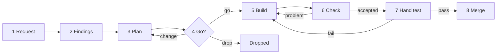
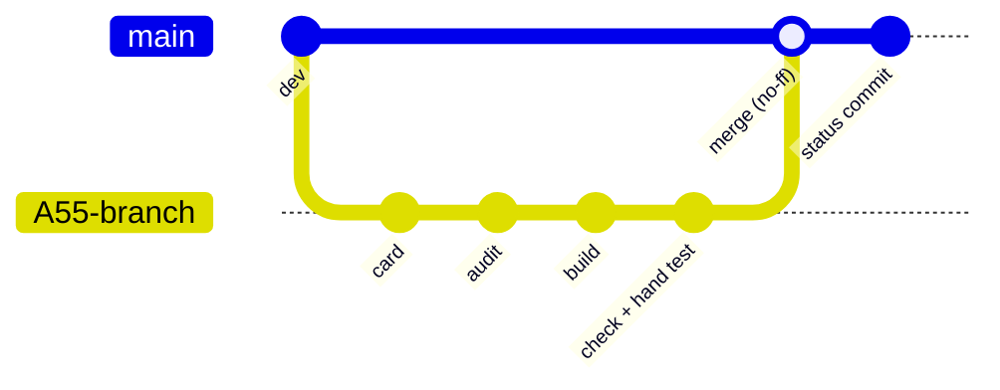

# Dev Loop Overview

Every change to AntiNotepad is an **item**. An item has a name like `A55-split-view-clip` (an ID, a dash, a short
description) and one **item card**: a text file that grows as the item moves along. Anyone can open the card and see why
the item exists, what you agreed to, and where it stands.

## The eight phases

| # | Phase | In plain words | Who | Left on the card |
|---|---|---|---|---|
| 1 | Request | Your words, copied exactly | master chat | Request |
| 2 | Findings | Why this is needed, what the app does today, proof | master (small items) or a helper with Codex (bigger) | Findings |
| 3 | Plan | What it will do instead, how it will be tested, which files may change | master | Plan, Files |
| 4 | Go | You say go, change, or drop | **you** | Go (your words) |
| 5 | Build | The code gets written | Codex, run by a helper session | code on the item's branch, a report |
| 6 | Check | Automatic checks, then "did we build what was asked, no more?" | helper session | Check |
| 7 | Hand test | You try it in a test copy of the app | **you** | Hand test (your words) |
| 8 | Merge | The change joins the main line (`dev`) | master | merge note in STATUS |

## Three rules that never bend
- **Nothing is built before you say go.** The Plan ends with exactly one question: go, change, or drop.
- **Findings are never skipped,** even for tiny items. A bug must be *reproduced* before anyone fixes it; if it cannot be
  reproduced, the loop stops and asks you (an early bug was "fixed" without ever being reproduced).
- **Your installed copy is never touched.** All testing happens in a separate *dev copy*.

## When something goes wrong
A failed check sends the item back to Build as a *rework round* (`-r2`, `-r3`). Each failure gets a cause and a route; see
[Triage and Lessons](Triage-and-Lessons). Scope changes you ask for in the middle go back through Plan.

## Branches in one picture
Each item works on its own branch, so unfinished work never mixes with the main line.

(In the picture the main line is drawn as one line; in the repository it is `dev`. `main` only gets tagged releases, and
only when you say so.)

Next: [Who Does What](Who-Does-What).
