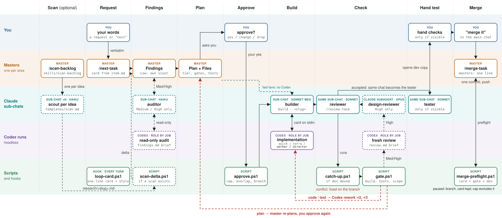

**In short**

Each item passes through eight phases, from your request to one commit on dev.
The card records the agreement; the scripts check readiness; separate reviews question the work.
You approve the plan and test visible results before the master merges them (`docs/loop.md`, "Phases").

# Dev loop overview



Read left to right. The optional backlog scan comes before an item exists. Medium/High items add an audit and fresh
Codex review; High adds design review. See [Who Does What](Who-Does-What) for exact brief headers and permissions
(`docs/loop.md`, "Tiers"; `.claude/skills/scan-backlog/SKILL.md`).

## 1. Request: capture the need

Say what you want changed. The master records your words instead of starting from its own proposed solution
(`docs/loop.md`, "Phases").

**Under the hood.** The master main chat (model unspecified by `docs/loop.md`, "Sessions") runs `/next-task`, from a
request or the next eligible STATUS row. It fills an item card from `.coord/templates/item.md`, leaves `## Request`,
and sets STATUS to `request`. The card stays untracked in the main dev checkout; no item branch exists yet
(`.claude/skills/next-task/SKILL.md`, step 1).

**Why it is safe.** An idea does not get an ID until you confirm its scope. Proposed items, decisions, release markers,
and lab-first designs stop for your answer (`.claude/skills/next-task/SKILL.md`, step 1).

## 2. Findings: establish what is true now

The master explains current behavior, relevant files, and risk before recommending a change. Bugs need a reproduction
(`docs/loop.md`, "Findings: what they must answer").

**Under the hood.** Low tier uses the master's own short scout, about ten tool calls. Medium/High uses a linked Haiku
`auditor` sub-chat, started with `start_session`, `use_worktree: false`, and `wake_when_done`. Its payload is a filled
`.coord/templates/findings.md`. It launches:

```bash
CODEX_SANDBOX=read-only bash .coord/tools/codex-run.sh director <ID-slug>-audit .coord/tasks/<ID-slug>-audit.md
```

The wrapper passes the brief on stdin to `codex exec`. Director is `gpt-6.1-sol` medium, with wrapper failover on
usage limits. The final audit answers kind, Now, reproduction, Where, risk, tier, and recommendation, ending `READY:`.
The Haiku chat copies only the report named on this invocation's successful `DONE` line and commits nothing
(`.claude/skills/next-task/SKILL.md`, step 2; `.coord/tools/codex-run.sh`, `attempt()`; `docs/agents.md`, "Launch").

If a backlog scan exists, Findings first runs `pwsh -NoProfile -File tools/scan-delta.ps1 -Slug <slug>` and reads the
scan, delta, and related cards. It does not replace a required Medium/High audit
(`.claude/skills/next-task/SKILL.md`, step 2; [Backlog Scans](Backlog-Scans)).

**Why it is safe.** Unreproduced bugs, current behavior already matching the request, and a changed interpretation stop
for the user. Audit Codex gets a read-only sandbox and may not write or build probes
(`.claude/skills/next-task/SKILL.md`, step 2; `.coord/templates/findings.md`).

## 3. Plan: define the finish line

Read Now beside After, then the tests and allowed files. Scope questions are answered before work begins
(`docs/loop.md`, "Plan: what the user approves").

**Under the hood.** The master runs `/next-task` step 3 with the Request and Findings as inputs. It fills Plan, Files,
Contracts, tier, and the "For Codex" brief. It selects each gate and names what that gate catches. STATUS becomes
`plan ready` (`.claude/skills/next-task/SKILL.md`, step 3).

**Why it is safe.** Tier defaults cannot be removed. More than about 400 lines of product code means lettered steps;
a touched file above 600 lines gets the "one job?" check. These bound complexity before implementation
(`docs/loop.md`, "Plan"; `docs/coding.md`, "Files: one job each").

## 4. Approve: you choose the scope

Choose approve, change, or drop. Your answer is kept in your own words (`docs/loop.md`, "Phases").

**Under the hood.** The master records `## Approve` and runs:

```powershell
pwsh -NoProfile -File tools/approve.ps1 -Task <ID-slug> -Prefix <prefix>
```

The script creates the branch and nested worktree, moves the untracked card/audit/research files there, and commits the
card. `-NoWorktree` is allowed only for user-authorized docs/tooling work; it uses the main checkout and pauses other
items (`.claude/skills/next-task/SKILL.md`, step 4; `tools/approve.ps1`; `docs/loop.md`, "Branches, worktrees and commits").

**Why it is safe.** The preflight rejects an unfilled Approve, a busy/dirty main checkout except permitted unstaged
STATUS, the active-item cap, and disallowed file overlap. Shared hot-file overlaps warn rather than block
(`tools/approve.ps1`; `tools/files-overlap.ps1`).

## 5. Build: implement the agreement

A builder sub-chat manages the implementation; the master stays focused on coordination
(`docs/loop.md`, "Sessions").

**Under the hood.** `/next-task` step 5 starts a linked Sonnet medium `builder` with the card and absolute worktree
path. It runs this command there:

```bash
bash .coord/tools/codex-run.sh <role> <ID-slug> .coord/tasks/<ID-slug>.md
```

For side tasks, the fast lane can omit Codex when the Claude session can do the work in minutes; Loop and D items retain a short card and branch (`docs/loop.md`, "Rules"). The complete card goes on stdin to `codex exec --sandbox workspace-write`. The card names the Codex role picked by the job
(`quick` Luna medium, `terra` Terra medium, `worker` Luna xhigh, `director` Sol medium); a director must spawn
`lens_reviewer` (Sol medium) before reporting. Outputs are changed files, the implementation report, wrapper
last-message report, and logs. Claude commits and pushes; Codex cannot write `.git`
(`docs/agents.md`, "Launch" and "Briefs"; `.codex/agents/lens-reviewer.toml`; `.claude/skills/next-task/SKILL.md`, step 5).

**Why it is safe.** Codex reads but never edits the card, never commits, and never launches or kills AntiNotepad.
Headless checks use a task-specific build folder. The wrapper stops a run after 45 minutes by default and stops on
non-limit failures. "Done means" lists offline checks only, since the sandbox cannot bind ports or open a browser (`docs/agents.md`, "Briefs"; `.coord/tools/codex-run.sh`, `attempt()`).

## 6. Check: compare request, approval, and result

A passing build is only part of acceptance. The reviewer also checks whether the work stayed within your agreement
(`docs/loop.md`, "Check: plan vs done").

**Under the hood.** The builder becomes the Sonnet medium `reviewer` and runs `/review-task`. It reads the card and
report, catches up if dev is not an ancestor, then runs `pwsh -NoProfile -File tools/gate.ps1 -Task <round>`. Medium/High
gets a fresh Sol Codex reviewer (medium by default; `CODEX_REVIEW_EFFORT` can override it) through the wrapper's `reviewer` tier and `.coord/templates/review.md`; High
then gets the Opus `design-reviewer` via the Agent tool. The reviewer writes gate/verdict lines and each plan difference
under `## Check` (`.claude/skills/review-task/SKILL.md`, steps 1–4; `docs/agents.md`, "Launch").

**Why it is safe.** Scope outside Files fails on item branches, excluding `.coord/` paths and explicit loose/CI modes; the gate records `Head:` for commit matching.
Missing report sections, a rework verdict, or a broken "Must not change" blocks acceptance. An unapproved difference
asks the user; failures get a cause before another run. Catch-up uses merge, never rebase
(`tools/gate.ps1`; `.claude/skills/review-task/SKILL.md`, steps 1–4a; `tools/catch-up.ps1`).

## 7. Hand test: judge what the screen shows

Try the listed checks in the dev copy and report the result. High tier always has a hand test; other invisible items
can skip it (`docs/loop.md`, "Tiers" and "Gates menu").

**Under the hood.** The same Sonnet medium chat becomes `tester`. Only after acceptance, it runs `tools/dev.ps1` from
its worktree, verifies EXE, DATA, app log, and expected dev badge, then gives the plan's UI checks plus new report checks.
It records your answer verbatim in `## Hand test`, commits, and reports to the master
(`.claude/skills/review-task/SKILL.md`, step 5).

**Why it is safe.** Dev and installed copies have separate identities. The launcher verifies the dev owner before
replacement and rejects installed images; dev data can point to a moved notes folder, so it must still be checked.
Hand tests queue oldest accepted first. A catch-up with `RETEST: yes` requires another hand test
(`docs/dev-loop.md`, "Dev copy"; `docs/loop.md`, "Branches"; `.claude/skills/review-task/SKILL.md`, step 5).

## 8. Merge: integrate checked work

Tell the master to merge the accepted item. Integration gets another gate run, not just a copy of the branch result
(`.claude/skills/merge-task/SKILL.md`, steps 1–4).

**Under the hood.** The master runs `pwsh -NoProfile -File tools/merge-preflight.ps1 -Task <ID-slug>`, checks scope,
squashes the branch onto dev, gates on dev, updates STATUS and lessons, and makes one item commit. It pushes and removes
the worktree without force, then deletes the branch locally and remotely
(`.claude/skills/merge-task/SKILL.md`, steps 1–8).

**Why it is safe.** The preflight refuses an incomplete card, dirty item checkout, branch behind dev, or stale/failing
gate. Behind-dev work goes back to its own session. A dev gate failure stops the push; cleanup refuses leftover files.
Moving `main` for a release needs the user's explicit go (`tools/merge-preflight.ps1`;
`.claude/skills/merge-task/SKILL.md`, steps 1, 4, 7; `docs/loop.md`, "Branches").

## Sources

- `docs/loop.md`: Phases; Findings; Plan; Gates menu; Check; Tiers; Sessions; Branches.
- `.claude/skills/next-task/SKILL.md`: steps 1–5.
- `.claude/skills/review-task/SKILL.md`: steps 1–5, including failure triage 4a.
- `.claude/skills/merge-task/SKILL.md`: steps 1–8.
- `.claude/skills/scan-backlog/SKILL.md`, `tools/scan-delta.ps1`: optional research.
- `.coord/templates/item.md`, `.coord/templates/findings.md`, `.coord/templates/review.md`: payload contracts.
- `docs/agents.md`, `.coord/tools/codex-run.sh`, `.codex/agents/lens-reviewer.toml`: models, sandbox, reports.
- `.claude/agents/design-reviewer.md`: Opus review.
- `tools/approve.ps1`, `tools/files-overlap.ps1`, `tools/catch-up.ps1`, `tools/gate.ps1`, `tools/merge-preflight.ps1`.
- `docs/dev-loop.md`, `tools/dev.ps1`: dev-copy launch and isolation.
- `docs/coding.md`: size and responsibility checks.
