# Loop History

How the loop became what it is. Built from commit subjects on `dev` (names and dates are from git; 2026-10-28 to
2026-10-29). Version numbering: v1 was C13 through C25; v2 and v2.1 are below.

```mermaid
flowchart LR
    C13["C13 dev-loop kit<br/>10-28"] --> C17["C17 roadmap view"]
    C17 --> C19["C19 sub-session routing"]
    C19 --> C20["C20 branch + worktree"]
    C20 --> C22["C22/C23 idea numbering"]
    C22 --> C24["C24 roadmap page"]
    C24 --> C25["C25 dev copy handoff"]
    C25 --> C26["C26 item card = v2"]
    C26 --> C27["C27 session naming"]
    C27 --> C28["C28 cheap checks = v2.1"]
```

| Item | Date | What it added | Why |
|---|---|---|---|
| **C13-dev-loop-kit** | 10-28 | The gate script, the CONTRACTS self-test, the Codex lens reviewer, the review skills and the first `docs/loop.md`. Its own review found a gate that could pass falsely; fixed in a rework round (r2), and r3 made rework rounds gate against all their briefs. | Checks that run the same way every time instead of by memory |
| **C17-roadmap-view** | 10-28 | `/roadmap`: the Plan as a table, rebuilt by a hook; one ID, one scope per row | See the plan at a glance |
| **C19-subsession-routing** | 10-29 | Every Codex run happens in its own linked, visible helper session | You can see and stop what is running |
| **C20-branch-worktree-loop** | 10-29 | Every item on its own branch and folder; `dev` gets only merges plus one status commit each | Items cannot trample each other or `dev` |
| **C22-roadmap-step-rows**, **C23-idea-numbering** | 10-29 | One ID per idea with lettered steps; numbers only when you confirm an idea | IDs stopped multiplying for undecided ideas |
| **C24-roadmap-artifact** | 10-29 | Roadmap as a shareable page kept current by a hook (later: the local page is the default, the shared page only on request) | Easier reading |
| **C25-dev-instance-handoff** | 10-29 | `dev.ps1` replaces any running dev copy from any checkout; verified shutdown | One safe test copy; hand tests one at a time |
| **C26-item-card-loop** | 10-29 | One card per item; Findings for every tier; reproduce bugs first; gates chosen per item; bounds check; status card on every reply (`docs/loop.md` calls this **v2**) | Wasted work from unchecked assumptions (A53, A54) |
| **C27-session-naming** | 10-29 | One master (`Master <N> - loop v<V> - <slug>`); helper names `<ID>-<step>-<slug>`; master handover checklist (its commit subject also says "loop v2") | Clarity about who is who; safe hand-over of a long chat |
| **C28-loop-cheap-checks** | 10-29 | Format check on changed lines only; Codex ledger and logs shared across folders; triage by cause; lessons and reviewer scores; quiet relays (**v2.1**) | Stricter without burning usage on extra AI calls |

## Reading the pattern
- The first step was *checks* (C13), then *visibility* (C17-C19), then *isolation* (C20), then *order* (C22-C23), then
  *the card and discipline* (C26), then *names* (C27), then *cost control* (C28).
- Several of these were triggered by a real miss: an item that duplicated what dev already did (A53) and one built without a
  reproduction (A54).
- Next: [Loop v2.2 Plan](Loop-v2.2-Plan) (parallel items, catch up with dev, conflicts).

Other C numbers (for example C14-C16, C18, C21) are not covered here.
