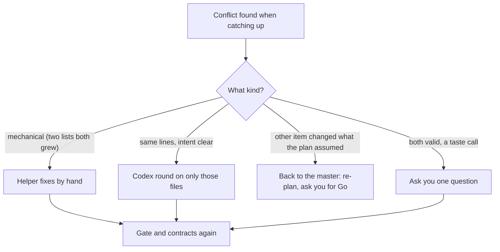

# Loop v2.2 Plan (a proposal)

> **Dormant.** The loop is still v2.1 on `dev` and `main`. The plan, change log and ready-made scripts are stored in the
> repository (`docs/v2.2/`, `tools/v2.2/`) and switch on only when you say so.

Nothing here is a rule yet. It is a plan for when more than one item runs at a time. The full version, with cost and the
files each step would touch, is `docs/loop-v2.2-plan.md` in the repository.

## The problem in one paragraph
Today the loop allows two items at once "if their file lists do not overlap", but nothing checks that, nothing brings an
item up to date with the main line (`dev`) while it waits, and when two changes clash the merge just stops.

## Three ideas

### 1. Parallel items
- A script compares the "files allowed to change" lists of items in flight. Shared files that every bug fix touches
  (the contracts and self-test files) only warn; any other shared file blocks the second item until the first merges.
- The reading phases (Request, Findings, Plan) of the next item can happen while another item is building.
- At most **two** items past "Go" at a time.
- Hand tests go through a **queue**: there is only one test copy of the app, so one item is tried at a time.
- The master keeps a small "in flight" table in STATUS.

### 2. Catching up with dev
Merge the latest `dev` into the item's branch (never rebase, since branches are already pushed):
- **before Check**, so the checks see what will really be merged;
- **before Merge**, in case another item merged while this one waited.
Always run the gate again afterwards. The item's own helper session does this with a script; the master never does.

### 3. Merge conflicts

## Proposed steps, in order
| Step | In plain words |
|---|---|
| `step: files-overlap-check` | script that compares file lists |
| `step: in-flight-limit-and-board` | limit of two; in-flight table |
| `step: hand-test-queue` | one hand test at a time |
| `step: catch-up-script` | the "merge dev into my branch" script |
| `step: catch-up-points` | when, who, and re-checking after |
| `step: conflict-triage` | the four kinds of conflict and where each goes |
| `step: conflict-codex-round` | the Codex brief for small text conflicts |
| `step: rehearsal` | a practice run with throwaway items |

These names are not IDs: numbers are given only when you confirm the scope. Some steps change session rules, which by the
current version rule would make this "v3" rather than "v2.2"; that is your call.

Back to [Home](Home).
