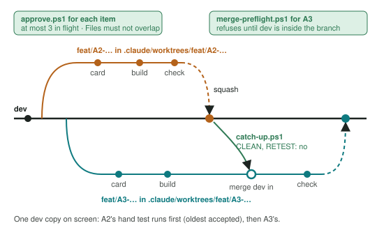
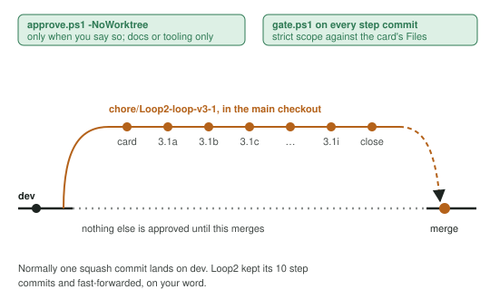

**In short**
Worktrees let a few independent items use separate folders while sharing the same Git history. The branch-only route uses the main folder for one authorized docs or tooling item, so other work waits. Both routes keep the same plan, checks and merge decision; the differences are isolation and scheduling (`docs/loop.md`, "Branches, worktrees and commits").

# Parallel worktrees and one branch

A **branch** names a line of changes. A **worktree** checks one branch out into a separate folder, so another session does not replace its files by switching branches. The normal loop keeps the master's checkout on dev and creates one item checkout at Approve (`docs/loop.md`, "Branches, worktrees and commits"; `tools/approve.ps1`, branch creation). See [Glossary](Glossary).

## Parallel worktrees



### Start only as much work as the checks can separate

The default limit is **three items past Approve**, counted from active Plan states in `.coord/STATUS.md`. `tools/approve.ps1`, the count block, refuses a fourth; `tools/loop-card.ps1` also warns if the count is already above three. The limit depends on the master keeping those states current. A user-paused item keeps its branch, worktree and card but does not count against the cap; resuming restores its earlier state (`docs/loop.md`, "Phases"). A research snapshot is a separate read-only route, not an approved implementation item (`.claude/skills/scan-backlog/SKILL.md`, steps 2–3).

At approval the master runs:

```powershell
pwsh -NoProfile -File tools/approve.ps1 -Task <ID-slug> -Prefix <prefix>
```

The script requires the main checkout on dev, an untracked card with filled Approve, no staged changes or merge markers, and tracked changes limited to unstaged STATUS. It then calls `tools/files-overlap.ps1` before creating the branch and nested worktree and moving/committing the planning files (`tools/approve.ps1`, checks and creation blocks).

`tools/files-overlap.ps1` reads only each card's Files section. It recognizes feat, fix, refactor, docs and chore item branches in `git worktree list --porcelain`, including an item checked out in the main folder. A shared non-hot exact path fails. Shared **hot files** warn instead: the contract table, SelfTest and its parts, loop/glossary rules and Claude skill files. These are often shared coordination points; the warning does not resolve a collision (`tools/files-overlap.ps1`, `$HotFiles`, branch pattern and comparison loop).

The exact hot paths/globs are in the script; the existing anchor files include `product/AntiNotepad/SelfTest/Contracts.cs`, `product/AntiNotepad/SelfTest.cs`, `docs/loop.md` and `docs/glossary.md`. A Files list describes intended ownership, not every possible behavioral dependency, so independent files still need the planned gates and bounds review (`docs/loop.md`, "Gates menu" and "Check: plan vs done").

### Catch up before checking and before merging

When dev is not an ancestor of the item tip, the **item's own session** runs:

```powershell
pwsh -NoProfile -File tools/catch-up.ps1 -Task <ID-slug>
```

It then pushes the branch and re-runs the gate. The master does not merge dev into another session's branch. These checkpoints are before Check and before Merge (`.claude/skills/review-task/SKILL.md`, step 2; `.claude/skills/merge-task/SKILL.md`, step 1; `docs/loop.md`, "Catching up with dev").

`tools/catch-up.ps1` fetches origin but merges **local dev**, using a merge rather than a rebase. If origin/dev differs it prints a note; it does not silently substitute that remote ref or push. It refuses a wrong branch, tracked edits outside STATUS or Git failures. Successful merge output is CLEAN; an already current branch prints UP TO DATE (script's branch, status, fetch and merge blocks).

The script compares incoming changed paths with the item's Files and prints `RETEST: yes` if any match, otherwise `RETEST: no`. After acceptance, yes repeats the hand test before Merge; no preserves its prior result. The comparison uses NUL-separated Git path output so paths with spaces remain whole. This is a file-touch trigger, not proof that unrelated files cannot affect behavior (`tools/catch-up.ps1`, `Write-Retest` and incoming diff; `.claude/skills/review-task/SKILL.md`, step 5).

### Resolve conflicts where the item context lives

A textual conflict leaves the merge open in the item checkout and prints conflicting paths, marking hot paths. The item's session resolves it while preserving both approved plans, commits the merge and re-runs the gate. If the incoming change invalidates an assumption of this item's Plan, that is a **semantic clash**: abort the merge and route to `plan`, so the master re-plans and asks for approval. It is not a routine code rework (`tools/catch-up.ps1`, conflict block; `.claude/skills/review-task/SKILL.md`, step 4a, `conflict` and `plan` rows).

### Hand tests take turns

There is one dev copy at a time. Accepted items hand test oldest first; there is no separate queue service in the shipped rules. The tester runs `tools/dev.ps1` immediately before the checks, gives the expected badge, and verifies EXE, DATA and log paths. A later launcher can replace the current dev copy, which is why parallel implementation does not imply parallel screen testing (`docs/loop.md`, "Branches, worktrees and commits"; `.claude/skills/review-task/SKILL.md`, step 5; `docs/dev-loop.md`, "Dev copy").

`tools/dev.ps1` uses a shared launcher mutex and a verified dev-instance handoff. The installed copy is excluded. Do not use an unscoped quit command as a substitute for the launcher (`docs/dev-loop.md`, "Installed and dev copies" and "Dev copy").

### Refuse a stale handoff to dev

Before squashing, the master runs:

```powershell
pwsh -NoProfile -File tools/merge-preflight.ps1 -Task <ID-slug>
```

`tools/merge-preflight.ps1` checks the committed branch card's Request, Plan, Approve (or era-one Go), Check and Hand test sections for missing/template content, plus unanswered "ask the user" lines. It requires an item checkout with tracked changes limited to STATUS, dev as an ancestor, and the newest matching gate report to contain `GATE: PASS` and a `Head:` matching the branch tip or an earlier revision followed only by this item's card/report commits. It rejects staged main-checkout changes and merge markers. It checks the card before ancestry, so an unfilled card can be the first refusal even when the branch is also behind (script's ordered checks; `.coord/reports/Loop2-loop-v3-1-rehearsal.md`, check 3).

A dirty gate records a `-dirty` suffix and cannot satisfy preflight; an earlier clean gate remains valid only when later commits touch only this item's card/report files (`tools/gate.ps1`, initial HEAD/status block; `tools/merge-preflight.ps1`, report checks).

Active masters tell each other in one line before a merge (`docs/loop.md`, "Sessions"). The normal merge is one squash commit on dev carrying the item, its STATUS edits and lessons. The master re-gates on dev, pushes, removes the worktree without `--force`, and deletes the branch. Unexpected files, failed gates and leftover worktree files stop that route (`.claude/skills/merge-task/SKILL.md`, steps 2–7).

## One branch, no extra worktree



This is allowed **only when the user says so, for docs or tooling items**. At Approve the master adds `-NoWorktree` to the same approval command. The script switches the main checkout to the item branch instead of creating an extra folder. Nothing else runs until the item merges: the cost is lost parallelism and the main checkout being occupied (`docs/loop.md`, "Branches, worktrees and commits", No worktree; `tools/approve.ps1`, `$NoWorktree` branches).

The card, scope gate, Check and merge preflight still apply. `tools/merge-preflight.ps1` recognizes the item branch in the main checkout and tells the master to switch to dev before the squash step; it does not switch or merge itself (`.claude/skills/merge-task/SKILL.md`, steps 1–3; `tools/merge-preflight.ps1`, final branch check).

### What Loop2-loop-v3-1 actually did

Loop2-loop-v3-1 used `chore/Loop2-loop-v3-1` in the main checkout, on the user's explicit 2026-10-30 instruction: "confirm. but theres no need for worktrees here." The user also said: "no parallel chats will be happening. you have full ownership of repo for this task. no need to message any other chat" (`.coord/tasks/Loop2-loop-v3-1.md`, Request and Approve).

That item also had an explicit history exception: small step commits were kept and dev fast-forwarded, rather than the normal one-item squash. Do not treat its commit sequence as the default merge recipe. The card's Check records steps 3.1a–3.1i and the rehearsal; the [worked example](Worked-Example-Loop2) gives the hashes and review results (`.coord/tasks/Loop2-loop-v3-1.md`, Branch, Decisions and Check).

## What the rehearsal proved

These are results from a throwaway clone at the then-current branch, with local bare origin, real builds and selftests. They are bounded evidence rather than a claim that every failure mode was exercised. Source for every check/result below: `.coord/reports/Loop2-loop-v3-1-rehearsal.md`, Checks and Surprises.

| Script or check | Risk it stops | Rehearsal evidence and boundary |
|---|---|---|
| `tools/approve.ps1` and `tools/files-overlap.ps1` | Starting without the approval/card checks or with conflicting planned files | Check 1 passed overlap, created the nested checkout and committed its card. This rehearsal did not test cap refusal or a hard/hot overlap collision |
| `tools/gate.ps1`, Scope | A non-coordination file outside the approved Files list slips through | Check 2a failed for stray `docs/agents.md`; 2b passed after removal. Build, selftest, seam, format and lint also passed. `.coord/` is excluded by the script's `Get-ChangedFiles` helper |
| `tools/merge-preflight.ps1`, card and ancestry | An incomplete or behind-dev item is squashed | Check 3 first refused an unfilled Check, then refused behind dev once the card was filled |
| `tools/catch-up.ps1` | The item misses newer dev changes or silently skips reconsidering its hand test | Check 4a merged unrelated `docs/coding.md`, printed CLEAN and `RETEST: no`; this rehearsal did not exercise a conflict or `RETEST: yes` |
| `tools/gate.ps1`, `Head:` | A gate result is detached from the revision being handed off | Check 4b wrote PASS with `Head:` equal to the new tip; check 5a accepted it. No stale-report rejection was injected in this rehearsal |
| `tools/merge-preflight.ps1` and normal merge cleanup | A merge proceeds before a clean, current, gated item exists | Check 5a passed; 5b added one dev commit, removed the worktree without force and deleted the branch |
| `tools/scan-delta.ps1` | An old scan hides changes in its evidence files | Check 6 found one of two Where files changed, a same-folder NEAR file and the merged card; `RESCAN: no` at exactly half. Forced-rescan deletion/majority cases were not part of this check |
| `.coord/tools/codex-run.sh` and nested project role files | Assuming a nested checkout cannot see the role definition | Check 7 read `lens_reviewer` from project files without a trust warning. It spawned nothing; runtime role spawning remains unproven there |
| `tools/loop-lint.ps1` | Live loop instructions refer to inconsistent rules or missing files | Check 8 returned `LOOP-LINT: PASS (37 files)`. It was a clean-run check, not an injected broken-link case |

The rehearsal reports eight checks overall (some have subchecks). A live `/scan-backlog` with Haiku scouts was not run. Neither table nor diagrams imply a live parallel app hand test occurred (`.coord/reports/Loop2-loop-v3-1-rehearsal.md`, Summary, check 7 and Hand checks).

## Sources

- `docs/loop.md` — Branches/worktrees/commits, catching up, Phases and Gates menu.
- `.claude/skills/next-task/SKILL.md` — Approve and builder dispatch.
- `.claude/skills/review-task/SKILL.md` — step 2 catch-up; step 4a conflict/plan routes; step 5 re-test and handover.
- `.claude/skills/merge-task/SKILL.md` — preflight, squash, dev gate and cleanup.
- `.claude/skills/scan-backlog/SKILL.md` — research snapshots.
- `tools/approve.ps1`, `tools/files-overlap.ps1`, `tools/loop-card.ps1` — cap and planned ownership.
- `tools/catch-up.ps1` — local-dev merge, Git-failure checks, incoming paths, RETEST and conflicts.
- `tools/merge-preflight.ps1`, `tools/gate.ps1` — card/ancestry checks, scope and exact revision evidence.
- `tools/scan-delta.ps1`, `tools/loop-lint.ps1` — research freshness and rule consistency.
- `tools/dev.ps1`, `docs/dev-loop.md` — one dev copy, handoff and installed-copy boundary.
- `.coord/tasks/Loop2-loop-v3-1.md` — authorized one-branch run and step-history exception.
- `.coord/reports/Loop2-loop-v3-1-rehearsal.md` — check results and limits.
