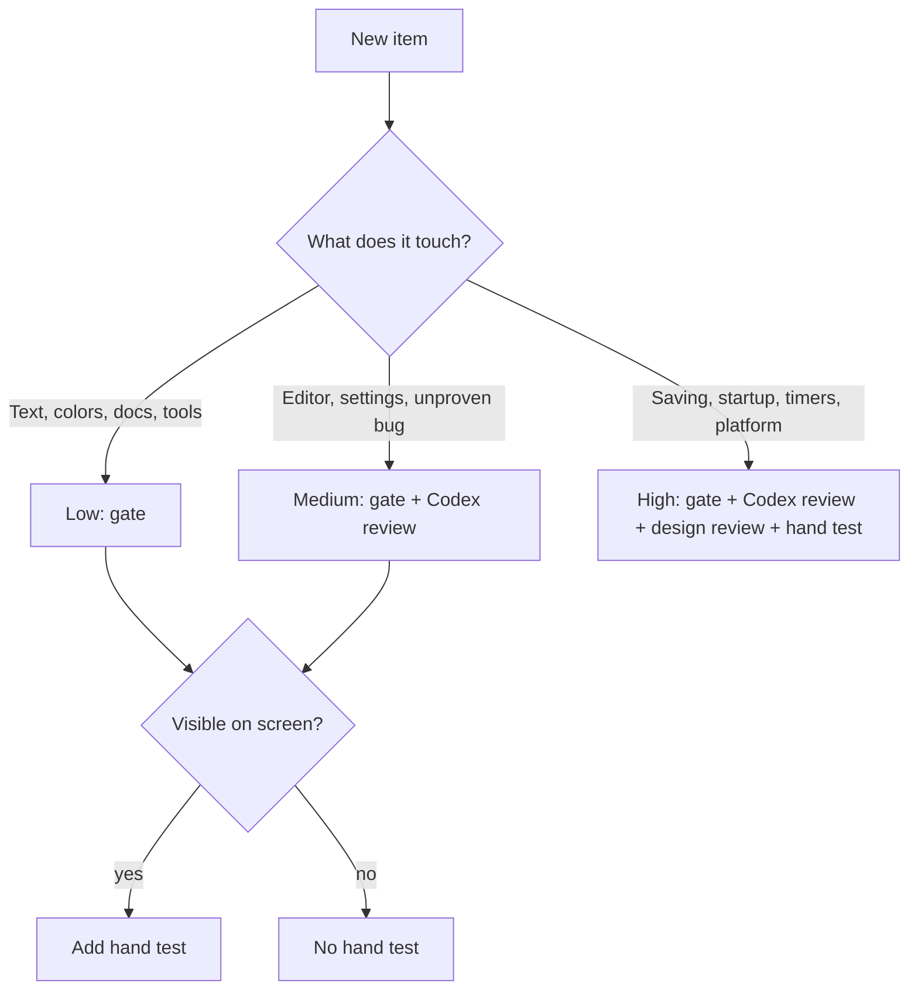

# Tiers and Gates

## Tiers: how risky is it?
The Plan sets a tier; Findings may raise it. When unsure, the higher tier is chosen. The tier decides how much checking
the item gets.

| Tier | What it touches | Who finds the facts | Checks it gets |
|---|---|---|---|
| **Low** | Text in the UI, theme colors, docs and tools, calculator rules with tests, pure moves of code | the master, with a short look (about ten steps) | the gate; your hand test if you can see it |
| **Medium** | Editor features (typing, cursor, selection, drawing), Settings, a new setting, any bug whose cause is not proven | a Codex audit | the gate + a fresh Codex review; hand test if visible |
| **High** | Saving and the notes folder, startup and quit, window styles and the taskbar, timers and background work, memory | a Codex audit | the gate + Codex review + a Claude design review; hand test always |

## Gates: what each one catches

| Gate | Catches | Runs for |
|---|---|---|
| **Gate script** (`tools/gate.ps1`) | build warnings or errors, failed self-tests, broken layering rules, "promises" that no longer hold (CONTRACTS), new formatting problems on changed lines, files changed that the Plan did not list, files growing too large | every item |
| **Codex fresh review** (`lens-review`) | logic mistakes, one feature breaking another, timing and shared-state bugs, inputs nobody thought of, missing clean-up | Medium, High |
| **Claude design review** | does it respect boundaries, will it be costly later | High |
| **New CONTRACTS row** | a fixed bug coming back unseen | every bug fix |
| **Reproduction test** | the bug is real and the fix addresses that bug | every bug |
| **Lab build** | a design change you have not approved yet | design changes: shown first, built for real only after approval |
| **Hand test** | what only a screen shows | anything visible; always for High |

The Plan may add gates; it may never drop the defaults of its tier.

## The gate script, check by check
The gate runs these checks (zero AI usage):
1. **Build:** must finish with 0 warnings.
2. **Self-test:** the app's built-in checks, including **LAYERS** (which code may call which) and **CONTRACTS** (promises
   between features, for example "the divider stays above the pager").
3. **Seam:** a script that bans platform calls in the wrong layer.
4. **Format:** only problems on lines this item changed fail (older ones are ignored).
5. **Scope:** changed files must be in the card's `## Files` list (a warning, not a failure, unless strict).
6. **Size:** warns when a code file crosses 600 lines or an already large file grows by more than 25.

## The bounds check
After the gates, the Check helper compares three things: what you **requested**, what you **approved** (Plan and Go), and
what was **done** (the report and the list of changed files). Every difference gets one line:
- **within plan**
- **justified** (why you do not need to decide)
- **ask the user** (it changes behavior or scope you did not approve: the item stops until you answer)

Side bugs noticed on the way are written down as proposed follow-ups and never fixed in passing.

Next: [Triage and Lessons](Triage-and-Lessons).
