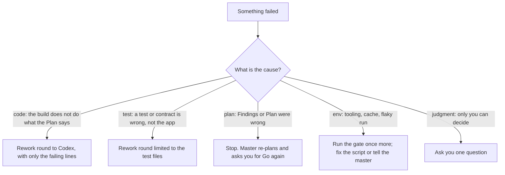

# Triage and Lessons

Things fail. The loop's answer is cheap and consistent: find **one cause**, send the problem to the right place, and write
one line so the loop can learn. (Added in C28-loop-cheap-checks, loop v2.1.)

## Triage: one cause, one route
Triage happens on every failure (a failed gate, a review that asks for rework, a failed hand test). It is done by the
helper that already holds the context, so it costs no extra agent.

| Cause | Meaning | Goes to |
|---|---|---|
| `code` | the build does not match the Plan | Codex, as a rework round (`-r2`, `-r3`) |
| `test` | a self-test, contract or probe is wrong | Codex, limited to test files |
| `plan` | Findings or Plan were wrong (wrong cause, missed a caller, impossible goal) | the master, then you |
| `env` | tooling, build cache, a flaky run | re-run once; then a one-line script fix or the master |
| `judgment` | only you can decide | you |

Only `code` and `test` go back to Codex, which keeps AI usage down. A third rework round goes to you instead of looping on.

## Lessons: what the loop missed
Each failure leaves one **Misses** line on the item card: where it was found, the cause, which check caught it, which
check *should* have caught it earlier, and a one-line lesson. At Merge the master copies these into `.coord/lessons.md`
and adds one **Scores** row for the item (rework rounds, gate failures, what each review found).

Real examples from the first lessons table:
| Item | Found at | Cause | What went wrong | Rule that grew from it |
|---|---|---|---|---|
| A53-split-divider-height | Hand test | plan | dev already did what was asked; nobody checked "Now" | Findings must state what the app does today |
| A54-link-hover-click | Check | plan | a bug was built without being reproduced | reproduce first, or stop and ask |
| A54-link-hover-click | Hand test | judgment | "all links or only shortened ones?" asked only at the end | scope questions are asked at Plan |

## Self-improvement, with your approval
If the same cause and the same "should have caught" appear **twice** with no rule change in between, the master proposes
an unnumbered `idea:` row naming the rule or checklist file to change. Rules change only through an item you approve.

## Reviewer scores
The Scores table shows whether each review earns its run. Many empty reviews on items that later had misses mean that
review's checklist needs a change, not that more reviewers are needed.

## Cost
A green item adds no AI calls (format check and ledger are scripts). A failure adds a few lines in a session that is
already open. The retro is one row at Merge.

Next: [Where Files Live](Where-Files-Live).
