# Where Files Live

Paths are relative to the repository root.

```mermaid
flowchart TD
    Root["Repository"] --> A["AGENTS.md and CLAUDE.md: project rules"]
    Root --> Docs["docs/: the rules in prose"]
    Root --> Coord[".coord/: the working notes of the loop"]
    Root --> Tools["tools/: scripts"]
    Root --> Claude[".claude/: skills, hooks, worktrees"]
    Root --> Prod["product/AntiNotepad: the app"]
    Docs --> D1["loop.md: the law"]
    Docs --> D2["agents.md: launching Codex"]
    Docs --> D3["dev-loop.md: dev copy and installing"]
    Docs --> D4["decisions.md: why things are the way they are"]
    Docs --> D5["wiki/: these pages"]
    Coord --> C1["STATUS.md: where everything stands"]
    Coord --> C2["tasks/: one item card per item"]
    Coord --> C3["reports/: Codex reports, gate reports"]
    Coord --> C4["templates/: blank cards and briefs"]
    Coord --> C5["lessons.md: misses and scores"]
    Claude --> K1["skills/: the three commands"]
    Claude --> K2["worktrees/: one folder per item in flight"]
```

## The files you will actually open
| File | What it is for |
|---|---|
| `.coord/STATUS.md` | the single "where are we" page: working rules, what is happening now, the plan |
| `.coord/roadmap.html` | the plan as a table, rebuilt automatically from STATUS; open it with `/roadmap` |
| `.coord/tasks/<ID-slug>.md` | the item card: request, findings, plan, your go, check, hand test |
| `.coord/reports/` | Codex reports and reviews (`<ID-slug>.md`, `.review.md`); gate reports are rebuilt each run and not saved in git |
| `.coord/lessons.md` | what the loop missed, and how each review scored |
| `docs/loop.md` | the rules of the loop (this wiki is the readable version) |
| `AGENTS.md` | project rules, loaded by both Claude and Codex |

## The three commands
| Command | Who runs it | Does |
|---|---|---|
| `/next-task` | master | Request to Go, then starts Build |
| `/review-task <ID-slug>` | build helper | Check: gates, bounds check, hands over to you |
| `/merge-task <ID-slug>` | master | Merge, gate again, one STATUS commit, push, clean up |

## Branches and worktrees
- `main`: releases only, tagged when you say so.
- `dev`: where finished items are combined. It receives only merges plus one status commit per merge.
- `feat/<ID-slug>`: one per item, created at Request. Each lives in its own folder, `.claude/worktrees/<ID-slug>`, so
  several items never share a working folder. After the merge the folder is removed and the branch is kept until the next
  release.

## The dev copy
There is one test copy of the app (`build/dev`) with its own data, never your real notes. Starting it from any item
replaces the previous one, so **hand tests happen one at a time**. Your installed copy is only upgraded when you ask.

Next: [Loop History](Loop-History).
