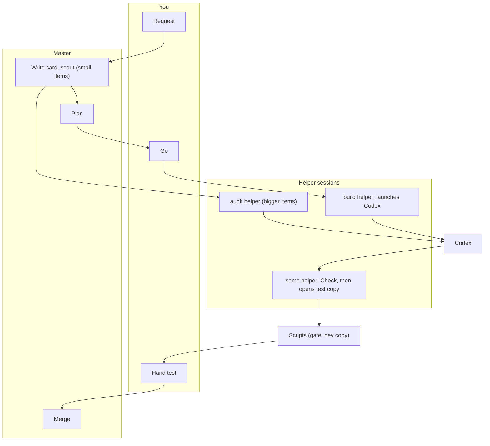
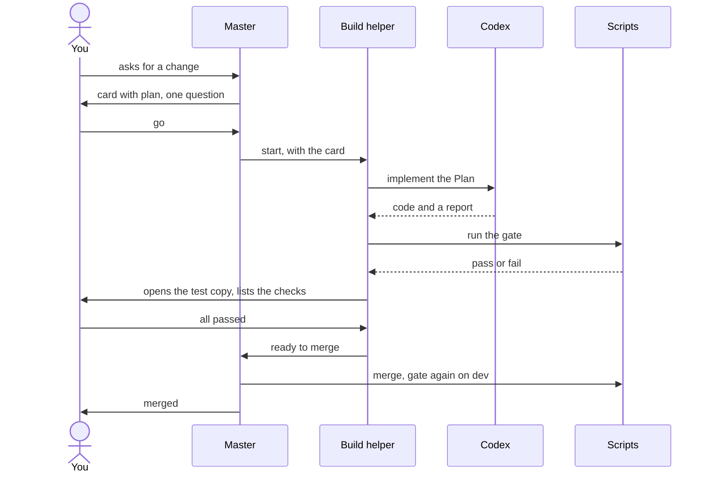

# Who Does What

Five kinds of actors. Only two of them are people-facing: you, and the master chat you talk to.

| Actor | What it is | Does | Never does |
|---|---|---|---|
| **You** | The owner | Make requests, say go / change / drop, try the build, say "release" | - |
| **Master** | The one Claude chat you talk to (named like `Master 1 - loop v2.1 - <slug>`) | Request, Findings (small items), Plan, asks for Go, starts helpers, Merge, keeps STATUS | Run Codex, build, or launch test copies itself |
| **Helper sessions** | Extra Claude chats, each with one item and one job | `audit` (find facts), `build` (run Codex, then Check, then your hand test), `review`, `test` | Touch the main line, STATUS, or invent item numbers |
| **Codex** | A separate AI that writes the code | Implements the Plan; a "lens reviewer" re-reads its work | Commit (it cannot write to git), edit the card, start or stop the app |
| **Scripts** | Plain programs, no AI | `tools/gate.ps1` (build + tests + rules), `tools/dev.ps1` (test copy), `tools/loop-card.ps1` (status reminder), `tools/roadmap.ps1` (plan page) | - |

Scripts are the cheapest check there is (no AI usage), so the loop runs them first and uses AI judgment only on what a
script cannot decide.

## Who is active in each phase

## Conversation shape

## Names you will see
- Master: `Master <N> - loop v<V> - <slug>`. There is one master at a time; a long chat is replaced by the next number.
- Helper: `<ID>-<step>-<slug>`, for example `A55-audit-split-view-clip`, then `A55-build-split-view-clip`. The helper renames
  itself as it moves on (`...-review-...`, `...-test-...`) so the sidebar shows where the item is.
- **Models:** audit helpers use a small model (Haiku); build/review/test helpers use Sonnet at medium effort; Codex runs a
  "director" (`gpt-6.1-sol`, medium) that can hand work to a "worker" (`gpt-6-luna`, extra-high). Details: `docs/agents.md`.

## Rules about who owns what
- The master owns the card's Request, Findings, Plan and Go, plus `STATUS` and `.coord/lessons.md`.
- Helpers own the card's Build, Check and Hand test parts. A helper that needs a decision from you asks it itself and
  writes your answer down word for word.
- Every Codex run happens in its own visible helper session that reports back to the master.

Next: [Worked Example A55](Worked-Example-A55).
