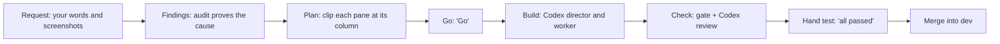

# Worked Example: A55-split-view-clip

A real item, followed through every phase. Source: its card, `.coord/tasks/A55-split-view-clip.md`.

**The problem:** in split view (two notes side by side), text that slides sideways while you swipe could paint *over* the
divider into the other note. **Tier:** Medium (a bug in editor drawing, cause not yet proven).

## 1. Request (2026-10-28/29)
You noticed it during an earlier hand test: "in split view, scrolling text overlaps across the divider; the divider should
crop the visual of each pane." Later you added three screenshots (right pane swiped toward next, left pane swiped toward
previous, and how it should look). The card keeps your words exactly.

## 2. Findings
Medium tier, so a **Codex audit** ran in a small helper session (`A55-audit-split-view-clip`). It found the cause in
code: both panes sit directly in one grid, and a swipe moves the *whole pane*; nothing stationary around the pane crops it
at the column edge. At width 320 a small pull moves the pane 64 px, 28 px past its edge. Your screenshots confirmed it
(the bug was reproduced, so building was allowed). The risk named: clipping the *moving* element would look right but not be
right.

## 3. Plan
- **After:** each pane sits in its own stationary clipping frame in its own column. Swipe motion stays exactly as it was,
  but nothing paints past the column edge.
- **Must not change:** divider look, swipe distances and timings, note binding and undo, top blur.
- **Questions asked up front:** sideways swipes only, or up/down too? (Your screenshots answered: sideways.) Should single
  view clip at the window edges? (Recommendation: no, out of scope.)
- **Tests:** a new CONTRACTS promise `split-pane-clipping`, plus six hand checks on screen.
- **Gates:** the gate script, the new contract, a Codex fresh review, and the hand test.
- **Files allowed to change:** four. Two layout files, `SelfTest.cs`, `Contracts.cs`.

## 4. Go
"Go" (2026-10-29). Only now does a branch get built.

## 5. Build
A build helper launched Codex: a director (Sol, medium) handed the coding to a worker (Luna, extra-high), then had a
"lens reviewer" re-read the result before reporting. Codex wrote the code and a report; the helper committed it
(Codex cannot).

## 6. Check
- Gate: **PASS**: build with 0 warnings, self-test pass, 11 contract rows (10 pass, 1 manual: actual pixels), 0 layering
  violations, 4 changed files all allowed.
- Codex fresh review: no proven problems, verdict *accept*.
- Bounds check, all lines "within plan" or "justified": for example one test file grew 30 lines over the 25-line
  advisory, justified as one focused check.
- No misses, nothing noticed to fix.

## 7. Hand test
The helper started the dev copy from the item's own folder and gave you the six checks. Your answer, word for word:
"all passed". (In the same message you asked for a floating scrollbar; that became a *new idea*, not part of A55.)

## 8. Merge
The master merged `feat/A55-split-view-clip` into `dev` with a no-fast-forward merge (commit `2a7a482`), re-ran the gate on
`dev`, and added one status commit (`ddb6ce7`). The item's folder was removed.

## What to take away
- The user's own words and screenshots are the spine of the card.
- The audit ran before the plan, so the plan could ask the right questions before any code existed.
- Everything a script can check was a script; the screen-only part was your hand test.

Next: [Tiers and Gates](Tiers-and-Gates).
